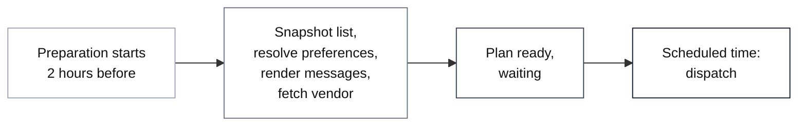

A broadcast sends the same notification to every user on a [list](/docs/lists) in one request. Use it for campaigns, newsletters and announcements, or for alerts that a large group needs at the same moment, like a stock market update.

Broadcasts are built for high throughput. You can send right away or schedule a send for later. For a time-sensitive scheduled send to a large list, turn on precompute. SuprSend prepares the broadcast before the scheduled time, so messages start going out right at the scheduled time, with no wait for preparation.

<Note>
  **Before you start:** create the [list](/docs/lists) you want to send to, and the template for the message.
</Note>

---

## Send a broadcast

<Tabs>
  <Tab title="Dashboard">
    Use the dashboard for one-off sends like a newsletter or a feature announcement. No code needed.

    1. Go to **Lists**, open the list and click **Run Broadcast**.

        <Frame>
          
        </Frame>

    2. Fill in the **Create Broadcast** form. It has three sections: **Who**, **What** and **When**.

        <Frame>
          
        </Frame>

        <table>
          <thead>
            <tr>
              <th style={{width: "1%", whiteSpace: "nowrap"}}>Section</th>
              <th style={{width: "1%", whiteSpace: "nowrap"}}>Field</th>
              <th style={{width: "1%", whiteSpace: "nowrap"}}>Required</th>
              <th>What to enter</th>
            </tr>
          </thead>
          <tbody>
            <tr>
              <td style={{whiteSpace: "nowrap"}}>Who</td>
              <td style={{whiteSpace: "nowrap"}}>List ID</td>
              <td style={{whiteSpace: "nowrap"}}>Yes</td>
              <td>The <code>id</code> of the list to send to. Filled in for the list you opened.</td>
            </tr>
            <tr>
              <td style={{whiteSpace: "nowrap"}}>Who</td>
              <td style={{whiteSpace: "nowrap"}}>Tenant</td>
              <td style={{whiteSpace: "nowrap"}}>No</td>
              <td>The <a href="/docs/tenants">tenant</a> this broadcast belongs to. Leave it as <strong>Global (no tenant)</strong> if you don't use tenants.</td>
            </tr>
            <tr>
              <td style={{whiteSpace: "nowrap"}}>What</td>
              <td style={{whiteSpace: "nowrap"}}>Template Name</td>
              <td style={{whiteSpace: "nowrap"}}>Yes</td>
              <td>The template to send.</td>
            </tr>
            <tr>
              <td style={{whiteSpace: "nowrap"}}>What</td>
              <td style={{whiteSpace: "nowrap"}}>Notification Category</td>
              <td style={{whiteSpace: "nowrap"}}>Yes</td>
              <td>The <a href="#choose-the-preference-category">category</a> for this send. Use a promotional sub-category, or a sub-category with <strong>Is commercial</strong> turned on, so the email carries <a href="/docs/user-preferences#one-click-unsubscribe">one-click unsubscribe</a> headers.</td>
            </tr>
            <tr>
              <td style={{whiteSpace: "nowrap"}}>What</td>
              <td style={{whiteSpace: "nowrap"}}>Selected Channels</td>
              <td style={{whiteSpace: "nowrap"}}>No</td>
              <td>Send on only some of the template's channels. If you leave it empty, the broadcast goes out on all channels.</td>
            </tr>
            <tr>
              <td style={{whiteSpace: "nowrap"}}>What</td>
              <td style={{whiteSpace: "nowrap"}}>Variable data</td>
              <td style={{whiteSpace: "nowrap"}}>No</td>
              <td>JSON for the template's variables. It's the same for every recipient. See <a href="#personalize-the-message">Personalize the message</a>.</td>
            </tr>
            <tr>
              <td style={{whiteSpace: "nowrap"}}>What</td>
              <td style={{whiteSpace: "nowrap"}}>Precompute</td>
              <td style={{whiteSpace: "nowrap"}}>No</td>
              <td>Prepare a scheduled broadcast in advance so sending starts at the scheduled time. See <a href="#precompute-a-scheduled-broadcast">Precompute a scheduled broadcast</a>.</td>
            </tr>
            <tr>
              <td style={{whiteSpace: "nowrap"}}>When</td>
              <td style={{whiteSpace: "nowrap"}}></td>
              <td style={{whiteSpace: "nowrap"}}>No</td>
              <td><strong>Immediately</strong>, <strong>After delay</strong> or <strong>Scheduled time (Local Time)</strong>. See <a href="#schedule-a-broadcast">Schedule a broadcast</a>.</td>
            </tr>
          </tbody>
        </table>

    3. Click **Trigger one-time Broadcast**. The form shows how many users the broadcast goes to and when. Check the details, then click **Confirm**. This step stops bulk sends going out by mistake.

        <Frame>
          
        </Frame>
  </Tab>
  <Tab title="API / SDK">
    Use the API or a backend SDK when you send broadcasts regularly from your product, like reminders or daily news.

    <CodeGroup>
    ```bash cURL
    curl -X POST "https://hub.suprsend.com/{workspace_key}/broadcast/" \
      --header 'Authorization: Bearer __YOUR_API_KEY__' \
      --header 'Content-Type: application/json' \
      --data '{
        "list_id": "equities-subscribers",
        "template": "pre-market-brief",
        "notification_category": "promotional",
        "data": {
          "market_date": "Nov 5, 2026"
        }
      }'
    ```

    ```python Python
    from suprsend import Suprsend, SubscriberListBroadcast

    supr_client = Suprsend("_workspace_key_", "_workspace_secret_")

    broadcast_body = {
        "list_id": "equities-subscribers",
        "template": "pre-market-brief",
        "notification_category": "promotional",
        "data": {
            "market_date": "Nov 5, 2026"
        }
    }

    inst = SubscriberListBroadcast(body=broadcast_body)
    resp = supr_client.subscriber_lists.broadcast(inst)
    print(resp)
    ```

    ```javascript Node
    const { Suprsend, SubscriberListBroadcast } = require("@suprsend/node-sdk");

    const supr_client = new Suprsend("_workspace_key_", "_workspace_secret_");

    const broadcast_body = {
      "list_id": "equities-subscribers",
      "template": "pre-market-brief",
      "notification_category": "promotional",
      "data": {
        "market_date": "Nov 5, 2026"
      }
    };

    const broadcast_instance = new SubscriberListBroadcast(broadcast_body);
    const response = supr_client.subscriber_lists.broadcast(broadcast_instance);
    response.then((res) => console.log("response", res));
    ```

    ```java Java
    import org.json.JSONObject;

    import suprsend.Suprsend;
    import suprsend.SubscriberListBroadcast;

    Suprsend suprClient = new Suprsend("_workspace_key_", "_workspace_secret_");

    JSONObject body = new JSONObject()
      .put("list_id", "equities-subscribers")
      .put("template", "pre-market-brief")
      .put("notification_category", "promotional")
      .put("data", new JSONObject().put("market_date", "Nov 5, 2026"));

    SubscriberListBroadcast broadcastIns = new SubscriberListBroadcast(body);
    JSONObject res = suprClient.subscriberLists.broadcast(broadcastIns);
    System.out.println(res);
    ```

    ```go Go
    import (
    	"context"
    	"fmt"
    	"log"

    	suprsend "github.com/suprsend/suprsend-go"
    )

    suprClient, err := suprsend.NewClient("_workspace_key_", "_workspace_secret_")
    if err != nil {
    	log.Fatalln(err)
    }

    broadcastBody := map[string]interface{}{
    	"list_id":               "equities-subscribers",
    	"template":              "pre-market-brief",
    	"notification_category": "promotional",
    	"data": map[string]interface{}{
    		"market_date": "Nov 5, 2026",
    	},
    }

    inst := &suprsend.SubscriberListBroadcast{Body: broadcastBody}
    resp, err := suprClient.SubscriberLists.Broadcast(context.Background(), inst)
    if err != nil {
    	log.Fatalln(err)
    }
    fmt.Println(resp)
    ```
    </CodeGroup>

    `list_id`, `template` and `notification_category` are required. For every field, see the [Trigger broadcast API](/reference/trigger-broadcast).

    SDK guides: [Python](/docs/python-broadcast) | [Node](/docs/node-broadcast) | [Java](/docs/broadcast-java) | [Go](/docs/broadcast-go)
  </Tab>
</Tabs>

---

## Choose the preference category

The [preference category](/docs/notification-category) decides which vendor credentials the broadcast uses and which [user preferences](/docs/user-preferences) apply to it.

Send broadcasts in a promotional sub-category. Don't use transactional or system categories: a bulk send in those categories can delay your other transactional and system notifications.

Always give recipients a way to unsubscribe from marketing emails. There are two ways to do it:

- **One-click unsubscribe header.** Emails sent in a sub-category with **Is commercial** turned on, which promotional sub-categories are by default, carry [one-click unsubscribe](/docs/user-preferences#one-click-unsubscribe) headers automatically. Recipients can unsubscribe right within their email. Gmail and Yahoo require bulk senders (>5,000 messages a day) to support RFC 8058 one-click unsubscribe.
- **Unsubscribe link in the email.** Add `{{$hosted_preference_url}}` to the template to link to the [hosted preference page](/docs/user-preferences#hosted-preference-page), where recipients can turn off the category.

---

## Personalize the message

There are two kinds of variables in a broadcast template:

- **Broadcast data** is the same for every recipient. For example, `{"promo_code": "SUMMER2024", "discount": "20%"}` sends the same code and discount to everyone. Pass it as **Variable data** on the dashboard or `data` in the API.
- **Recipient properties** change per user. Use `$recipient.<property>` in the template, like `$recipient.name`, and SuprSend fills in each user's own value.

---

## Schedule a broadcast

A broadcast sends right away unless you schedule it.

| Option | Dashboard | API |
|---|---|---|
| Send now | **Immediately** | Leave out `delay` and `trigger_at` |
| Send after a wait | **After delay**: days, hours, minutes and seconds to wait after you confirm | `delay`, for example `"1h30m"` |
| Send at a set time | **Scheduled time (Local Time)**: a date and time in your local time | `trigger_at`, an ISO 8601 date-time like `"2026-11-05T03:30:00Z"` |

---

## How a broadcast runs

When a broadcast starts, SuprSend works through these steps:

1. **Fetch the list.** It reads the users on the list.
2. **Load the template and vendors.** It loads the live template version and its channels, then the vendor set up for each of those channels in the category. If a channel has no vendor set up, SuprSend logs the error and skips that channel.
3. **Fetch user profiles.** It loads each user's channels and properties.
4. **Apply preferences.** It works out each user's active channels from their user and tenant preferences for the category. Users who opted out, or have no active channel, are skipped.
5. **Render messages.** It fills in the template for each user with the broadcast `data` and their `$recipient` properties. Users whose message fails to render are marked failed.
6. **Trigger notifications.** It calls each vendor's API to deliver the messages. Vendor credentials are checked only here, so wrong credentials show up as delivery errors in [message logs](/docs/message-logs).

The [broadcast execution log](/docs/broadcast-execution-logs) shows each step with its counts, and why users were skipped or failed.

---

## Precompute a scheduled broadcast

Steps 1 to 5 of [how a broadcast runs](#how-a-broadcast-runs) build the send plan before the first message goes out. On a large list, this can take 5 to 30 minutes. For a time-critical send, that delay can make the message stale by the time it reaches users.

Precompute runs steps 1 to 5 before the scheduled time and stores each user's rendered message. At the scheduled time, SuprSend only runs step 6, so sending starts right at the scheduled time.

Precompute works only on scheduled broadcasts, with **After delay** or **Scheduled time** (`delay` or `trigger_at` in the API). It's ignored on broadcasts sent immediately.

### When to turn it on

Turn it on when starting at the scheduled time matters more than reaching users who join the list at the last minute:

- **Notifications tied to a clock time**, like a pre-market brief, a flash sale or a live event starting.
- **Scheduled sends to large lists**, where building the plan at send time would push delivery past the scheduled time.

Leave it off for small lists, or when the list must be as up to date as possible at the moment of sending.

### Turn on precompute

<Tabs>
  <Tab title="Dashboard">
    In the **Create Broadcast** form, select **Precompute** in the **What** section. Then, under **When**, choose **After delay** or **Scheduled time (Local Time)**. Precompute only applies to scheduled broadcasts, so it has no effect if you leave **When** as **Immediately**.

    <Frame>
      
    </Frame>
  </Tab>
  <Tab title="API / SDK">
    Pass `precompute: true` together with `trigger_at` or `delay`.

    ```json
    {
      "list_id": "equities-subscribers",
      "template": "pre-market-brief",
      "notification_category": "promotional",
      "trigger_at": "2026-11-05T03:30:00Z",
      "data": {
        "market_date": "Nov 5, 2026"
      },
      "precompute": true
    }
    ```

    `precompute` is a boolean and defaults to `false`. It's ignored when the request has no `trigger_at` or `delay`.
  </Tab>
</Tabs>

### How precompute works

SuprSend starts preparing 2 hours before the scheduled time. When the plan is ready, the broadcast waits and dispatches at the scheduled time.



If you schedule a broadcast less than 2 hours ahead, SuprSend starts preparing right away. The plan may not be ready at the scheduled time, so the broadcast could be delayed. SuprSend finishes the plan first and then starts sending, so every message still comes from the same plan.

### Changes after the snapshot

Once preparation finishes, the plan is fixed. Changes you make after that don't reach this broadcast. They apply from the next one. On a large list, preparation runs in batches, so avoid edits while it's running: an edit made during preparation can reach part of the list.

This holds for every change after the snapshot:

- List changes: users joining or leaving, list syncs, and edits to a segment condition or database sync query.
- User and tenant changes: property edits and tenant branding used by the template.
- Preference and opt-out changes.
- Template edits.

For example, say you schedule a pre-market brief for 9:00 AM on your `equities-subscribers` list with precompute on. SuprSend snapshots the list at 7:00 AM, 2 hours before. Between 7:00 AM and 9:00 AM:

- 1,200 users join the list. **They don't get today's brief.** They get tomorrow's.
- 300 users switch their email preference off. **They still get today's brief on email.**
- A product manager edits the template's subject line. **Today's brief goes out with the old subject line.**

### See precompute in the logs

The [broadcast execution log](/docs/broadcast-execution-logs) shows each preparation step with a timestamp: when the list was snapshotted (`total_users`), how many profiles were loaded, the preference summary, and when the plan became ready (`final_users`). Timestamps use the timezone set in the dashboard's timezone switcher.

<Frame caption="Preparation steps for a precomputed broadcast">
  
</Frame>

<Frame caption="The plan is ready and the broadcast waits for the scheduled time">
  
</Frame>

#### Broadcast ends early with no recipients

If preparation ends with 0 users to send to, SuprSend ends the broadcast right away and logs the reason. It doesn't wait for the scheduled time. This happens when, for example:

- The template fails to render for every user.
- No vendor is set up for the broadcast's category.
- Every user has opted out of the category.
- The category is turned off for the broadcast's tenant.

<Frame caption="A plan with no one to send to ends right away">
  
</Frame>

---

## Check delivery

The [broadcast execution log](/docs/broadcast-execution-logs) shows a summary of the broadcast up to the moment it triggers notifications. To see whether each message was delivered, open [message logs](/docs/message-logs) and filter by the broadcast's `broadcast_id`.

---

## FAQ

<AccordionGroup>
  <Accordion title="Why were some users on the list skipped?">
    The [broadcast execution log](/docs/broadcast-execution-logs) shows the reason for each skipped user:

    - **Unsubscribed:** the user opted out of the broadcast's category, or of the channel within it.
    - **Missing channel:** the user doesn't have that channel in their profile, or the channel was marked inactive after an earlier hard bounce.
  </Accordion>
  <Accordion title="The broadcast shows Partial Failure. What went wrong?">
    Some messages sent and at least one didn't. The most common cause is a template variable that some users don't have:

    ```text
    email: template rendering error error: missing variables in template: "$recipient.name"
    ```

    Those users have no `name` on their profile, so their message couldn't render and was dropped. Everyone else still got theirs. Fill in the property for those users, or add a fallback with the [`default`](/docs/handlebars-helpers#default) helper, like `{{default $recipient.name "there"}}`, so the message renders even when the property is missing. Keys in **Variable data** must also match the template exactly.
  </Accordion>
  <Accordion title="Nothing was sent and the log mentions vendor configuration">
    The vendor is picked by the root category of the broadcast's category. If no vendor is set up for that root category and channel, that channel isn't sent. The log also shows this error when the vendor doesn't support broadcasts.
  </Accordion>
  <Accordion title="Does a broadcast reach users who join a segment list after I schedule it?">
    Yes, without precompute. SuprSend refreshes a segment or database sync list right before sending, so the broadcast reaches whoever matches at send time. With precompute on, the list is fixed when preparation starts. See [Changes after the snapshot](#changes-after-the-snapshot).
  </Accordion>
  <Accordion title="In Sandbox, the broadcast ran but nobody received anything">
    Sandbox delivers email, SMS and WhatsApp only to verified channels. Check that each recipient's channel value, like their email or phone number, exactly matches one in **Developers → Verified Channels**. A missing country code or a stray space is enough to miss.
  </Accordion>
  <Accordion title="What if the list is still updating when precompute takes its snapshot?">
    For a database sync or segment list, SuprSend refreshes the list when preparation starts and waits for the sync to finish. If the sync doesn't finish, the broadcast fails.

    Static lists, including ones updated by CSV upload or through the API, are snapshotted as they are. SuprSend can't tell whether you're still adding or removing users, so finish updating the list before preparation starts, or users you add later miss this broadcast.
  </Accordion>
  <Accordion title="My dynamic list was empty when I scheduled the broadcast. Will precompute still send to it?">
    Yes, if the list fills up before preparation starts. Precompute reads the list when it takes the snapshot, not when you schedule the broadcast.
  </Accordion>
  <Accordion title="Can two precomputed broadcasts use the same list?">
    Yes. Each broadcast takes its own snapshot and builds its own plan.
  </Accordion>
  <Accordion title="What if the vendor credentials are wrong on a precomputed broadcast?">
    Preparation checks that a vendor is set up for each channel, but the credentials are used only when SuprSend calls the vendor at the scheduled time. Wrong credentials fail delivery on that channel, and the errors show up in [message logs](/docs/message-logs).
  </Accordion>
</AccordionGroup>
