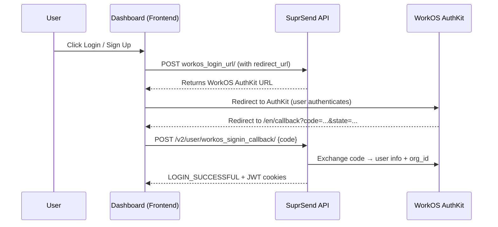

By default, self-hosted SuprSend uses a passwordless email+code flow for dashboard authentication. WorkOS integration replaces this with [AuthKit](https://workos.com/docs/user-management), giving you enterprise SSO, social logins (Google, GitHub, etc.), SAML, email verification, and magic-link login - all managed through your WorkOS dashboard.

<Info>
  **Optional feature** - WorkOS integration is optional. If you do not set it up, the default email+code login continues to work unchanged.
</Info>

---

## Prerequisites

- A [WorkOS](https://workos.com) account with **User Management** enabled
- A running SuprSend self-hosted deployment
- Your dashboard URL (for example `https://app.yourdomain.com`) and API URL (for example `https://api.yourdomain.com`)

---

## Step 1 - Configure WorkOS dashboard

### 1.1 Create an application

In the WorkOS dashboard, create a new application (or use an existing one) and note down:

| Value | Where to find it |
| --- | --- |
| **Client ID** | Dashboard → API Keys → Client ID |
| **Secret Key** | Dashboard → API Keys → Secret Key |
| **AuthKit base URL** | Dashboard → Authentication → AuthKit → your hosted domain (for example `https://your-app.authkit.app`) |

### 1.2 Add the redirect URI

Under **Redirects**, add your frontend sign-in callback page as an allowed redirect URI:

```
https://app.yourdomain.com/en/callback
```

Replace `app.yourdomain.com` with your actual dashboard domain.

### 1.3 Register the webhook endpoint

Under **Webhooks**, add a new endpoint pointing at your SuprSend API:

```
https://api.yourdomain.com/v1/workos_webhook/
```

Enable the following event:

- `magic_auth.created` - on self-hosted deployments WorkOS sends the magic-link login email itself; SuprSend only verifies and acknowledges this event

Copy the **Webhook Secret** that WorkOS generates - you will need it in the next step.

---

## Step 2 - Add WorkOS secrets

Add the following keys to your existing `suprsend-secrets.yaml` (inside `stringData`):

```yaml title="suprsend-secrets.yaml (additions)"
  # WorkOS secret key (from WorkOS dashboard → API Keys)
  workosApiKey: "<your-workos-secret-key>"
  # WorkOS webhook signing secret (from WorkOS dashboard → Webhooks)
  workosWebhookSecretKey: "<your-workos-webhook-secret>"
```

Apply the updated secret:

```bash
kubectl apply -f suprsend-secrets.yaml -n suprsend
```

---

## Step 3 - Update `suprsend-values.yaml`

### 3.1 Backend (suprsend API)

Add the following under the `suprsendapi` section:

```yaml title="suprsend-values.yaml (suprsendapi section)"
suprsendapi:
  config:
    # ... existing config ...

    # Enable WorkOS integration
    isWorkosIntegrated: "true"
    # WorkOS Client ID (from WorkOS dashboard → API Keys)
    workosClientId: "<your-workos-client-id>"
    # WorkOS AuthKit hosted base URL (for example https://your-app.authkit.app)
    workosSigninBaseUrl: "<your-authkit-base-url>"

  secret:
    existingKubeSecret: "suprsend-secrets"
    # ... existing secret keys ...

    # WorkOS API secret key reference
    workosApiKeyKey: "workosApiKey"
    # WorkOS webhook secret reference
    workosWebhookSecretKey: "workosWebhookSecretKey"
```

### 3.2 Frontend (suprsend dashboard app)

The dashboard frontend uses `viteEnableWorkosLoginFlow` to toggle the login mode. Set it to `"true"` to enable WorkOS:

```yaml title="suprsend-values.yaml (suprsendApp section)"
suprsendApp:
  config:
    # email editor token, contact suprsend to get one
    viteEmailEditorToken: "<your-token>"

    # Set to "true" to activate the WorkOS login flow.
    # Set to "false" (or leave unset) to use the default email+code login.
    viteEnableWorkosLoginFlow: "true"
```

<Info>
  To switch back to the default email+code login at any time, set `viteEnableWorkosLoginFlow` to `"false"` and re-run `helm upgrade`.
</Info>

<Note>
  Some older guides use `viteDisableWorkosLoginFlow`. The dashboard does not read that key: use **`viteEnableWorkosLoginFlow`** and set it to `"true"` to enable WorkOS. If it is unset, self-hosted dashboards use email+code login.
</Note>

---

## Step 4 - Apply changes

```bash
helm upgrade my-suprsend suprsend/suprsend \
  -f suprsend-values.yaml \
  -n suprsend
```

Wait for the `suprsendapi` and `suprsendApp` pods to restart:

```bash
kubectl rollout status deployment/suprsend-suprsendapi -n suprsend
kubectl rollout status deployment/suprsend-suprsend-app -n suprsend
```

---

## How the auth flow works



**Login response types**

| `response_type` | Meaning | Frontend action |
| --- | --- | --- |
| `LOGIN_SUCCESSFUL` | User authenticated, membership active | Set auth state, redirect to dashboard |
| `MEMBERSHIP_DEACTIVATED` | Membership exists but is inactive | Show deactivation message |
| `LINK_INVALID` / `LINK_EXPIRED` | Code exchange failed | Show error with retry option |

---

## Webhook integration

SuprSend registers a webhook endpoint at `/v1/workos_webhook/` to receive events from WorkOS. For self-hosted deployments, the relevant event is:

| Event | Purpose |
| --- | --- |
| `magic_auth.created` | When a user requests a magic-link login, WorkOS fires this event. On self-hosted deployments SuprSend acknowledges it but does not send an email - WorkOS sends the magic-link login email itself. |

**How it works**

1. User requests a magic-link login via WorkOS AuthKit.
2. WorkOS fires `magic_auth.created` to `https://api.yourdomain.com/v1/workos_webhook/`.
3. SuprSend verifies the webhook signature using `WORKOS_WEBHOOK_SECRET`.
4. On self-hosted deployments SuprSend does not send the login email - WorkOS delivers the magic-link email itself.
5. Duplicate events are deduplicated using Redis (event IDs are cached for 3 days).

<Note>
  WorkOS AuthKit handles email verification natively - users must verify their email before they can authenticate. The `email_verification.created` event is not required for self-hosted deployments.
</Note>

---

## FAQ

<AccordionGroup>
  <Accordion title="Why does the dashboard still show email+code instead of WorkOS?">
    Ensure `viteEnableWorkosLoginFlow` is `"true"` in `suprsendApp.config` (if it is unset, self-hosted dashboards default to email+code login). Run `helm upgrade` with your values file so the dashboard pod restarts with the updated setting; the frontend reads this flag at runtime from the pod's environment.
  </Accordion>

  <Accordion title="Why do I see LINK_INVALID after returning from WorkOS?">
    - Check that the redirect URI in the WorkOS dashboard **exactly** matches your callback URL (for example `https://app.yourdomain.com/en/callback`).
    - In `suprsendapi.config`, confirm `workosClientId` and `workosSigninBaseUrl` match the **Client ID** and **AuthKit base URL** from the WorkOS dashboard.
    - In your Kubernetes secret, confirm `workosApiKey` matches the **Secret Key** from WorkOS (API Keys). At runtime these appear as `WORKOS_CLIENT_ID`, `WORKOS_API_KEY`, etc. on the API deployment - verify the pods picked up the updated values after `helm upgrade`.
  </Accordion>

  <Accordion title="Why aren't magic-link login emails being delivered?">
    - In self-hosted mode, the magic-link login email is sent by WorkOS, not by SuprSend - check the email settings in your WorkOS dashboard.
  </Accordion>
</AccordionGroup>
