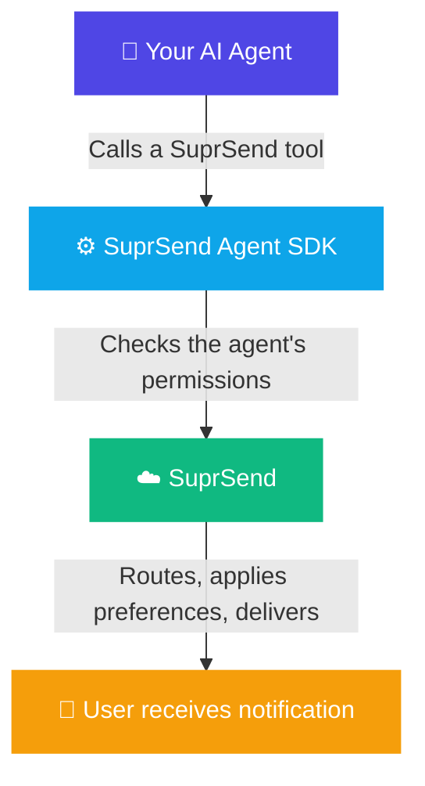

The Agent SDK is for AI agents running in production that need to notify people as part of their own decisions. It gives your agent a set of ready-made SuprSend tools: trigger a workflow, read and update users, tenants and preferences, track events, and edit and publish workflows and templates.

<Note>
  This is distinct from the [MCP server](/reference/mcp-overview), which is for interactive AI-client sessions. The Agent SDK is for agents making decisions at runtime.
</Note>

<Info>
  The Agent SDK is in early access and isn't published as a package yet. It's a Python toolkit for LangChain and LangGraph agents, and for agents that use OpenAI-style function calling. [Join the waitlist](https://www.suprsend.com/agent-sdk) to get access.
</Info>

---

## How it works

You define the notification system in SuprSend - workflows, templates, channels, preferences. The Agent SDK gives the agent tools that call SuprSend. To notify someone, the agent calls the trigger tool with a workflow slug and a payload, and SuprSend handles routing, delivery, and preferences.

---

## When to use Agent SDK vs MCP

| | Agent SDK | MCP Server |
|---|---|---|
| **Use case** | Agents triggering notifications in production | Developers building in their IDE and ops users chatting through Claude, ChatGPT, VS Code, Gemini, and other MCP clients with their SuprSend account |
| **Environment** | Your agent's runtime (server, cloud function) | Interactive AI-client sessions |
| **Tools exposed** | The tool categories you enable, with a switch to block all writes | Full tool set, scoped by URL (`?tools=`) and by SuprSend role |
| **Auth** | Account service token | Sign in with your SuprSend account (OAuth via WorkOS) |

---

## Guardrails

<CardGroup cols={2}>
  <Card title="Permissions" icon="lock">
    Turn tool categories on or off for each agent, and block all writes with one switch. A second switch blocks destructive tools, which today covers only removing users from a list. An agent that only sends notifications can be limited to the trigger tool.
  </Card>
  <Card title="One workspace" icon="layer-group">
    Pin the agent to one workspace, so it can't act on production by mistake.
  </Card>
  <Card title="Payload validation" icon="shield-check">
    Link a JSON schema to a workflow, and SuprSend rejects trigger payloads that don't match it. See [validate workflow payload](/docs/validate-workflow-payload).
  </Card>
  <Card title="Retries" icon="rotate">
    Pass an idempotency key with a trigger and reuse it when you retry, and SuprSend won't send the notification twice within 24 hours. Without one, the SDK sets a new random key on each call.
  </Card>
  <Card title="Logs" icon="chart-line">
    Agent-triggered notifications appear in your SuprSend logs like any other trigger, with the workflow, payload, routing, and delivery outcome.
  </Card>
  <Card title="Template governance" icon="palette">
    Notifications use your existing templates, so design and messaging stay consistent. Leave template editing out of the agent's permissions to keep it that way. If you set no permissions, the agent gets every tool.
  </Card>
</CardGroup>

---

## Example use cases

- **Document processing** - Agent completes extraction and notifies the user with results via email.
- **Security monitoring** - Agent detects anomalous login and triggers push and email alerts simultaneously.
- **Sales automation** - Agent identifies buyer intent and routes a follow-up to the right channel.
- **Customer support** - Agent resolves a ticket and sends the customer a summary via in-app and email.
- **Ops and incident response** - Agent detects a delivery failure and escalates to on-call via Slack.

---

## Get started

The Agent SDK is currently in early access.

<CardGroup cols={2}>
  <Card title="Join the waitlist" icon="rocket" href="https://www.suprsend.com/agent-sdk">
    Sign up for early access.
  </Card>
  <Card title="Book a demo" icon="calendar" href="https://calendly.com/suprsend">
    Talk to the team about your use case.
  </Card>
  <Card title="MCP Server" icon="server" href="/reference/mcp-overview">
    For development-time agent tooling.
  </Card>
  <Card title="Workflow trigger API" icon="code" href="/reference/trigger-workflow-api">
    Trigger workflows from your own backend with the REST API.
  </Card>
</CardGroup>
