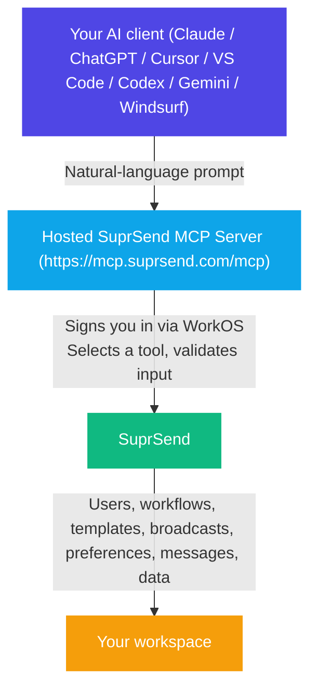

<Note>
  **Beta — launched 2026-10-08.** The hosted SuprSend MCP server is live in Beta. The endpoint, auth flow, and tool list may still change before general availability.
</Note>

The SuprSend MCP server is the first public step toward a headless SuprSend. Any AI client — Claude, ChatGPT, Cursor, VS Code with GitHub Copilot, Codex, Gemini, Windsurf — can now drive your SuprSend account over MCP. Manage users, lists, workflows, templates, broadcasts, preferences, messages, and delivery analytics in natural language, without opening the dashboard or writing SDK code.

<CardGroup cols={2}>
  <Card title="Claude Code" icon="terminal" href="/reference/mcp-quickstart-claude">
    Connect from the `claude` terminal client.
  </Card>
  <Card title="Claude Desktop & Claude.ai" icon="comments" href="/reference/mcp-quickstart-claude">
    Add a custom connector in the Claude app.
  </Card>
  <Card title="Cursor" icon="arrow-pointer" href="/reference/mcp-quickstart-cursor">
    Install the SuprSend agent plugin for Cursor.
  </Card>
  <Card title="VS Code + Copilot" icon="code" href="/reference/mcp-quickstart-vscode">
    Add it in `.vscode/mcp.json` for Copilot Chat.
  </Card>
  <Card title="ChatGPT" icon="message" href="/reference/mcp-quickstart-chatgpt">
    Add a custom MCP server from the Plugins menu.
  </Card>
  <Card title="Codex CLI" icon="rectangle-terminal" href="/reference/mcp-quickstart-codex">
    Install the SuprSend agent plugin for Codex.
  </Card>
  <Card title="Gemini CLI" icon="sparkles" href="/reference/mcp-quickstart-gemini">
    Add it to `~/.gemini/settings.json`.
  </Card>
  <Card title="Windsurf" icon="wind" href="/reference/mcp-quickstart-windsurf">
    Add it in `~/.config/devin/mcp_config.json`.
  </Card>
</CardGroup>

---

## What you can do

<AccordionGroup>
  <Accordion title="Set up your account and seed test data" icon="wand-magic-sparkles">
    - "Create a tenant called `routewise-eu` and set the `shipment-updates` category to opt-in by default."
    - Seed test users with channel addresses, then subscribe them to objects so they inherit the right preferences.
    - Configure a preference hierarchy: category defaults, tenant overrides, user choices.
    - Add users to lists and objects before writing any code.
  </Accordion>
  <Accordion title="Build workflows, templates, and broadcasts in natural language" icon="screwdriver-wrench">
    - "Build a quote-expiring reminder workflow that sends email 2 hours before expiry, then falls back to WhatsApp."
    - Publish templates and translations from draft to live.
    - Dry-run a broadcast to confirm the list size and template exist before sending.
  </Accordion>
  <Accordion title="Query delivery analytics" icon="chart-line">
    - "Show me the email delivery rate by tenant for the last 7 days as a line chart."
    - "Which workflows failed most often this week?"
    - Results render as a chart or table in clients that support MCP Apps (see below).
  </Accordion>
  <Accordion title="Debug a user's experience" icon="bug">
    - "User `usr_8f3k2m` says they never got the invite — show me their profile, channel addresses, and preferences."
    - Preview a message with images and links masked.
    - Check whether a preference category is opted out at the user, tenant, or object level.
  </Accordion>
</AccordionGroup>

---

## How it works

The SuprSend MCP server is a remote Streamable HTTP server. Your AI client connects directly to a hosted endpoint — there is nothing to install locally and no CLI to run.

- **Endpoint:** `https://mcp.suprsend.com/mcp`
- **Protocol:** built for MCP spec `2026-07-28`. Clients built against the 2025 spec also connect, but they do not get the `skills/list` and `skills/get` methods.
- **Workspace scoping:** append the workspace slug to the URL path to pin the connection — for example `https://mcp.suprsend.com/mcp/staging`. Without a slug, the server picks the workspace it finds first.
- **Tool scoping:** add a `?tools=` query to limit which tool groups the client sees — for example `https://mcp.suprsend.com/mcp?tools=users.*,data.*`. Scope can only reduce access, never widen it.

### Authentication

Sign in with your SuprSend account. When your AI client connects for the first time, it opens a browser window and the SuprSend MCP server runs an OAuth handshake through WorkOS. After sign-in, your SuprSend role decides what the agent can do:

- **Members** see only read tools.
- **Admins** see every tool, including the ones that send real notifications.

OAuth via WorkOS is the only supported auth path today. JWT bearer tokens for programmatic agents are coming soon.

### MCP Apps and Skills

Hosts that implement the MCP Apps extension get richer output than plain text:

- **`data.query`** results render as a chart (metric, line, bar, stacked bar, or pie) or as a table with a Refresh button.
- **`messages.get_content`** renders an actual message preview — email, Inbox, SMS, and push — with images and links off and OTPs or link queries masked. Slack messages render as JSON.

Clients that implement the MCP Skills extension get four SuprSend Skills on top of the tool list:

- `suprsend-semantic-layer` — maps your workspace concepts (tenants, categories, channels) to data queries.
- `suprsend-template-schema` — the full template schema for every channel.
- `suprsend-workflow-schema` — the full workflow node schema.
- `suprsend-docs-support` — pulls answers from SuprSend's docs.

### Easier install: the SuprSend plugins

Two plugin packages wrap the hosted server install so your client picks it up in one step:

- **`suprsend/claude-plugin`** — for Claude on web, Desktop, mobile, Cowork, and Claude Code.
- **`suprsend/agent-plugin`** — for VS Code, GitHub Copilot CLI, Codex, Cursor, Kiro, and other Agent Plugins 1.0.0 clients.

Both plugins ship a config that connects to `https://mcp.suprsend.com/mcp` — nothing runs on your machine. The per-client quickstarts above include the plugin command alongside the manual MCP config.

---

## Learn more

<CardGroup cols={2}>
  <Card title="Tool list" icon="wrench" href="/reference/mcp-tool-list">
    Every tool in the server, grouped by category, with read vs write labels.
  </Card>
  <Card title="Prompt cheatsheet" icon="clipboard-list" href="/reference/mcp-prompts">
    Copy-paste prompts for workflows, users, templates, broadcasts, and analytics.
  </Card>
  <Card title="Agent plugin" icon="plug" href="/reference/agent-plugin">
    Install the SuprSend plugin in Claude, VS Code, Copilot CLI, Codex, Cursor, or Kiro.
  </Card>
  <Card title="Task Management example app" icon="rocket" href="/reference/mcp-example-task-management-app">
    Build a notification system end to end using MCP prompts.
  </Card>
</CardGroup>
